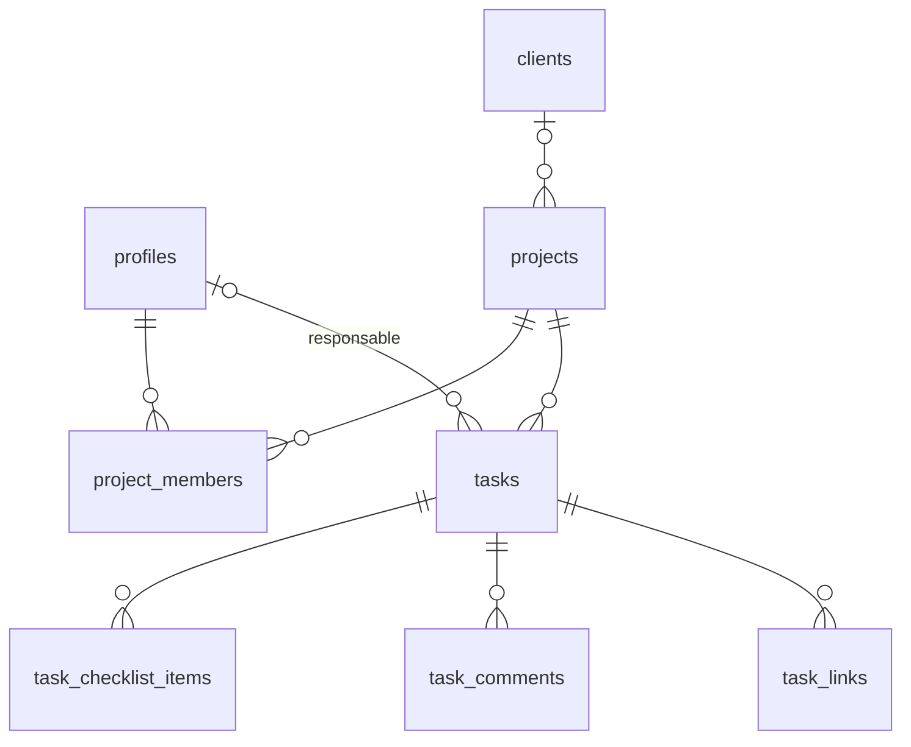

# Architecture — Kelenix

## Vue d'ensemble

```
Navigateur ──► Next.js (proxy.ts : session + redirections)
   │              ├─ /login           page de connexion (Supabase Auth, e-mail + mot de passe)
   │              ├─ /                dashboard (composant client, état de section dans l'URL ?s=&p=&t=)
   │              └─ actions.ts       Server Actions : créer / retirer un membre (clé service, propriétaire seulement)
   │
   └──(clé anon + JWT utilisateur)──► Supabase Postgres ── RLS sur toutes les tables
```

- **Lectures et écritures courantes** : depuis le navigateur via le client Supabase, avec la
  session de l'utilisateur. Postgres applique la RLS, les contraintes `check` et des triggers :
  l'autorisation et la validation sont donc garanties côté serveur. Zod valide aussi les
  formulaires pour des messages clairs.
- **Opérations d'administration** (création/suppression de comptes) : Server Actions qui
  vérifient le rôle propriétaire puis utilisent la clé service, jamais exposée au navigateur.
- **Cache client** : TanStack Query. Compteurs, progressions et « Mes tâches » sont dérivés des
  mêmes listes : toute modification les met à jour. Le Kanban est optimiste.

## Modèle de données



| Table | Points clés |
|-------|-------------|
| `profiles` | 1-1 avec `auth.users` (créé par trigger) ; `role` = `owner` / `collaborator` |
| `clients` | nom, entreprise, e-mail, notes |
| `projects` | `status` (Prévu, En cours, En pause, Terminé), `archived_at` (archivage réversible), client facultatif |
| `project_members` | membres autorisés ; le créateur est ajouté automatiquement |
| `tasks` | statut (À faire, En cours, Reprogrammé, Terminé), priorité, responsable (membre du projet ou « À assigner »), échéance, `is_blocked` + explication obligatoire, `completed_at` (posé par trigger au passage à « Terminé ») |
| `task_checklist_items`, `task_comments`, `task_links` | sous-éléments d'une tâche (URL http/https uniquement) |
| `time_entries` | sessions (début / fin) par personne et par tâche, de type `work` ou `pause`, source `timer` ou `manual`, description du travail ; une seule ouverte par personne ; écritures uniquement via `start_timer`, `pause_timer`, `resume_timer`, `stop_timer`, `log_time` (heures oubliées), `edit_time_entry` (correction justifiée), `set_time_entry_description` — pas de temps futur, pas de chevauchement, 16 h max |
| `time_entry_changes` | journal des corrections : ancienne et nouvelle plage, auteur, justification (lecture seule) |

Règles calculées (non stockées) : **retard** = échéance passée et statut ≠ Terminé ;
**avancement** = tâches terminées / total (`src/lib/domain.ts`). Les statistiques (par semaine,
par statut, par membre) et la feuille de temps (travail par personne et par jour, pauses à part,
`src/lib/time.ts`) sont calculées côté client dans `src/lib/stats.ts`, à partir des tâches
que la RLS rend visibles : un collaborateur ne voit que les chiffres de ses projets.

## Permissions (RLS)

| Donnée | Propriétaire | Collaborateur |
|--------|--------------|---------------|
| Projets | tout | lecture des projets dont il est membre |
| Membres de projet | gestion | lecture sur ses projets |
| Tâches + checklist + liens | tout | lecture/écriture sur ses projets |
| Temps passé | tout lire, supprimer | lire sur ses projets, démarrer / mettre en pause son propre chronomètre |
| Commentaires | tout lire, supprimer | lire sur ses projets, écrire en son nom, supprimer les siens |
| Clients | gestion | lecture des clients de ses projets |
| Profils / rôles | change les rôles des autres | modifie son nom ; ne peut pas changer de rôle |

Garde-fous complémentaires par trigger : responsable obligatoirement membre du projet ;
retrait d'un membre → ses tâches du projet repassent « À assigner » ; personne ne modifie son
propre rôle. Tests : `supabase/tests/rls.test.sql` (`pnpm test:db`).

## Arborescence

```
src/
  app/            login/, page.tsx (dashboard), actions.ts, layout.tsx
  components/
    dashboard/    shell, sections (overview, projects, my-tasks, clients, statistics), charts, dialogs, team, tasks/
    ui/           composants shadcn/ui
  lib/            domain.ts (règles métier), schemas.ts (Zod), queries.ts (données), supabase/
  proxy.ts        rafraîchissement de session et redirections
supabase/         config.toml, migrations/, seed.sql (démo locale), tests/
e2e/              parcours Playwright
```
